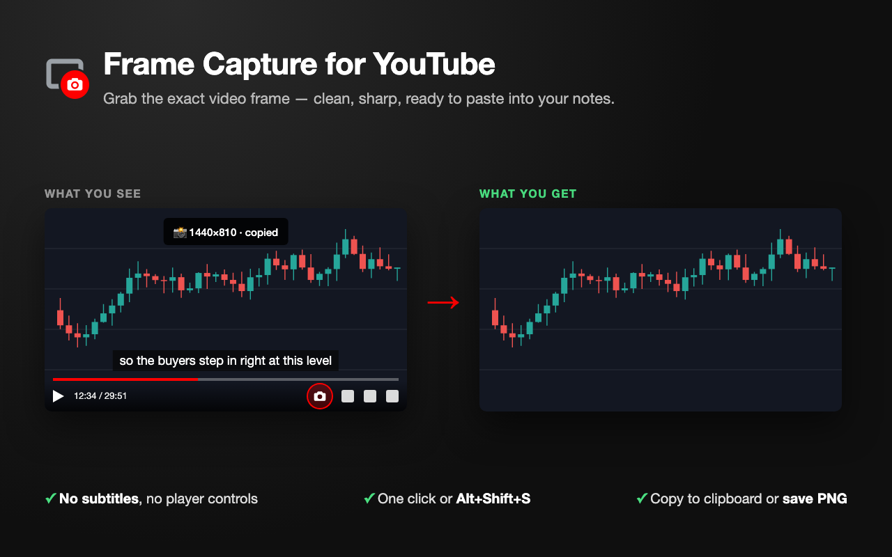

# Frame Capture for YouTube

Chrome extension that captures the current YouTube video frame as a clean PNG — no subtitles, no player controls.



It draws the frame straight from the `<video>` element onto a canvas. Subtitles and player controls are separate HTML overlays, so they never end up in the image — no need to turn captions off, open DevTools, or crop by hand.

## Features

- Camera button in the YouTube player's control bar
- Keyboard shortcut `Alt+Shift+S` (`Option+Shift+S` on Mac), remappable at `chrome://extensions/shortcuts`
- Copy to clipboard, save as PNG, or both
- Max width setting (default 1440 px, `0` = native resolution, never upscales)
- Saved files are named `<video title> — HH-MM-SS.png` inside a Downloads subfolder

## Install from source

1. Open `chrome://extensions` and turn on **Developer mode**
2. Click **Load unpacked** and pick this folder
3. Refresh any open YouTube tab

After editing the code, click reload ↻ on the extension card **and refresh the YouTube tab** — an already-open tab keeps running the old content script.

## Project layout

| Path | What |
| --- | --- |
| `manifest.json` | Manifest V3 — bump `version` before every Web Store upload |
| `content.js` / `content.css` | Player button, frame capture, toast |
| `background.js` | Keyboard shortcut and file downloads |
| `options.html` / `options.js` | Settings popup |
| `icons/` | Extension icons, generated by `scripts/make-icons.py` |
| `store/` | Web Store images — each `.png` is rendered from the `.html` next to it |
| `scripts/` | Build and asset scripts |

## Scripts

```bash
./scripts/build.sh                      # → dist/frame-capture-for-youtube-<version>.zip
./scripts/render-store.sh               # re-render store/*.png with headless Chrome
python3 scripts/make-icons.py icons     # re-render icons/ (no dependencies)
```

## Chrome Web Store submission

Everything the [Developer Dashboard](https://chrome.google.com/webstore/devconsole) asks for, ready to paste.

### Before the first submission

- **Account → Contact email:** enter an email and click the verification link Google sends. Publishing is blocked until this is verified.

### Package

- Upload `dist/frame-capture-for-youtube-<version>.zip` from `./scripts/build.sh`
- Each new upload needs a higher `version` in `manifest.json`

### Store listing

| Field | Value |
| --- | --- |
| Name | Frame Capture for YouTube *(from manifest)* |
| Summary | *(from manifest `description`)* Capture the current YouTube video frame as a clean PNG — no subtitles, no player controls. |
| Category | Productivity → Tools |
| Language | English |
| Icon | `icons/icon128.png` |
| Screenshots (1280×800) | `store/screenshot-1.png`, `store/screenshot-2.png` |
| Small promo tile (440×280) | `store/promo-small.png` |
| Marquee promo tile (1400×560) | `store/promo-marquee.png` |

All store images are 24-bit PNG without alpha, as the store requires.

<details>
<summary><b>Description</b></summary>

```text
Capture the exact YouTube frame you're looking at — clean, sharp, and ready to paste into your notes.

Taking a screenshot of a YouTube video usually means hiding the subtitles, waiting for the player controls to fade, and cropping the result by hand. Frame Capture for YouTube skips all of that. It grabs the frame straight from the video itself, so subtitles, the progress bar, and player buttons never end up in your image.

What it does

• Clean frames, every time: Subtitles and player controls are never part of the capture. You don't need to turn captions off first.
• One click or one shortcut: A camera button sits in the YouTube player's control bar, or you can press Alt+Shift+S (Option+Shift+S on Mac). You can change the shortcut at chrome://extensions/shortcuts.
• Copy or save: The frame goes to your clipboard, ready to paste into Obsidian, Notion, Google Docs, Slack, or any other app. You can also save it as a PNG file, or do both.
• Consistent image size: Set a maximum width (1440 px by default) so every capture matches. Set it to 0 to keep the video's native resolution. Frames are never upscaled beyond the source, so they stay sharp.
• Useful file names: Saved files are named after the video title and timestamp, for example "Video Title — 00-12-34.png". They go into a folder of your choice inside Downloads.

Why install it

• For learners and note-takers: Pull slides, charts, diagrams, and code from lectures, courses, and tutorials straight into your notes.
• For traders and analysts: Keep a clean copy of the chart at the exact moment the presenter explains it.
• For anyone who screenshots videos: It replaces a five-step routine (open DevTools, resize the window, hide captions, select the area, capture) with a single click.

Private by design

Frame Capture for YouTube runs entirely in your browser. It collects no data and has no tracking or analytics. Nothing is sent anywhere. The only things it stores are your own settings.

Note: DRM-protected videos, such as purchased or rented movies, can't be captured. This is a browser restriction.
```

</details>

### Privacy practices

| Field | Value |
| --- | --- |
| Single purpose | Captures the current frame of a YouTube video as a PNG image, without subtitles or player controls. |
| `storage` justification | Saves the user's capture settings (max width, copy/download toggles, folder name). |
| `downloads` justification | Saves the captured frame as a PNG file to the user's Downloads folder when the user enables that option. |
| `clipboardWrite` justification | Copies the captured frame to the clipboard so the user can paste it into notes. |
| Host permission justification (`youtube.com`) | The content script reads the video element on YouTube pages to draw the current frame and adds a capture button to the player. |
| Are you using remote code? | **No, I am not using remote code** — all scripts ship inside the package. |
| Data usage | Leave every data type unchecked — the extension collects nothing. |
| Certifications | Tick all three. |

### Distribution

- **Public**, **Unlisted** (only people with the link), or **Private** (only listed testers)

## License

[MIT](LICENSE)
